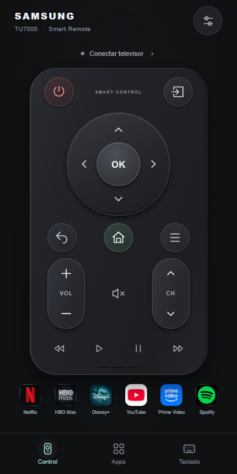

# Control remoto Samsung para Android

Control por Wi-Fi para Samsung Smart TV, desarrollado y probado con un **Samsung UN50TU7000 (serie 7)**. El celular se conecta directamente al televisor: **no necesita una PC encendida ni un servidor**.

## Descargar la app

**[Descargar Control Samsung 2.1 para Android](https://juanpablopeiro.com.ar/controlsamsung/Control-Samsung-Android.apk?v=2.1)**

También disponible en **[GitHub Releases](https://github.com/jppeiro90/control-remoto-samsung/releases/latest)**.

Requiere Android 8 o posterior. El APK está firmado para instalación directa; no está publicado en Google Play. Para actualizar, instalalo sobre la versión anterior y conservá la vinculación con el TV.

<p align="center"></p>

## Funciones

- Cruceta circular, OK, Inicio, Volver, Menú y selección de fuente.
- Apagado, volumen, silencio, canales, guía y teclado numérico.
- Reproducción, pausa, avance y retroceso.
- Accesos con logos a Netflix, HBO Max, Disney+, YouTube, Prime Video y Spotify.
- Consulta de aplicaciones instaladas en el TV y accesos personalizados.
- Búsqueda del televisor en la red y vinculación guardada en cada celular.
- Encendido opcional por Wake-on-LAN, sujeto al soporte y configuración del TV.

La compatibilidad de botones y aplicaciones puede variar con el modelo, la región y el firmware. Las apps de streaming deben estar instaladas y tener la sesión iniciada en el televisor.

## Instalar y conectar

1. Abrí el enlace de descarga desde el celular e instalá el APK. Si Android lo solicita, permití la instalación desde la aplicación con la que abriste el archivo.
2. Conectá el celular y el TV a la **misma red Wi-Fi**. Encendé el televisor.
3. Abrí los ajustes del control, buscá el TV o ingresá su IP. En el TU7000: **Configuración → General → Red → Estado de red → Configuración IP**.
4. Tocá **Conectar** y aceptá **Control Samsung Android** en la pantalla del TV. Para esta primera autorización necesitás el control físico o los botones del televisor.
5. Repetí la vinculación en cada teléfono que quieras usar.

Si Fuente no responde, mantené presionado su botón para probar otra pulsación o acceder a Inicio. Si una app no abre, mantené presionado su logo para elegir otra variante del acceso.

## Código y compilación

El proyecto Android está en [`android/`](android/). Usa Java 17, Android SDK 35 y Gradle 8.11.1. La interfaz está empaquetada en el APK y los comandos de red se ejecutan desde Android; no se carga una página desde un servidor externo.

Abrí la carpeta `android` en Android Studio, o ejecutá desde ella:

```powershell
.\gradlew.bat testDebugUnitTest assembleDebug lintDebug
```

En macOS/Linux, con JDK 17 y el SDK Android configurados:

```sh
cd android
./gradlew testDebugUnitTest assembleDebug lintDebug
```

Para preparar herramientas portátiles y compilar desde Windows con Python 3:

```powershell
python -m pip install -r android/requirements-build.txt
python android/prepare_build.py
```

Este último método descarga herramientas oficiales a `%LOCALAPPDATA%/ControlSamsungBuild` y genera el APK en la raíz del proyecto. En la primera preparación acepta las licencias estándar del SDK Android. No modifica el PATH ni inicia servidores. Cada entorno de compilación utiliza su propia clave de prueba; para actualizar una instalación existente, la firma debe coincidir con la del APK instalado.

El proyecto incluye **14 pruebas unitarias** del protocolo y entrega de teclas. Ver [documentación Android](android/README.md).

## Privacidad

IP, token de autorización y huella del certificado del TV se guardan en el almacenamiento privado de cada teléfono. La app no pide credenciales de Netflix u otros servicios. Los archivos locales de conexión, claves de firma, adjuntos personales y registros de compilación están excluidos de este repositorio.

## Prototipo para PC

Los archivos `app.py`, `static/`, `requirements.txt` e `iniciar.bat` conservan el prototipo inicial. Es independiente de la app Android y no hace falta ejecutarlo para usarla. Sus pruebas se ejecutan con `python -m unittest discover -s tests -v`.

## Referencias y recursos

- [Protocolo comunitario Samsung TV WebSocket](https://github.com/xchwarze/samsung-tv-ws-api).
- [Documentación de compilación y vinculación](android/README.md).
- [Fuentes de los logos](android/app/src/main/assets/ui/logos/sources.json) y [avisos de dependencias](android/app/src/main/assets/THIRD_PARTY_NOTICES.txt).

Proyecto independiente, sin afiliación con Samsung ni con los servicios de streaming. Los logos pertenecen a sus respectivas marcas.
